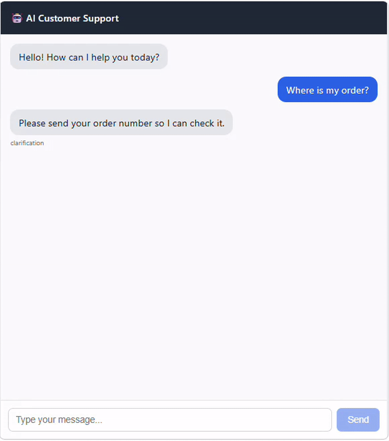
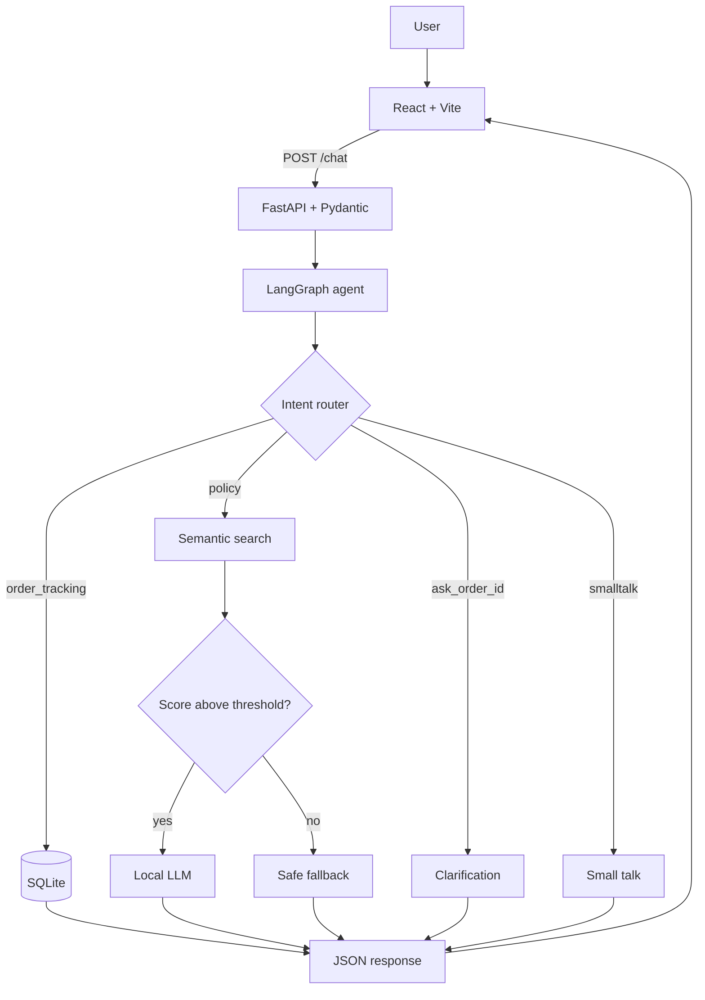
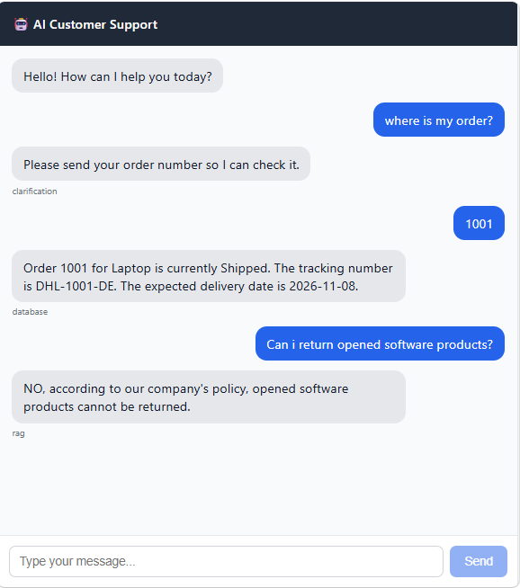

<div align="center">

# AI Customer Support Agent

**A full-stack AI application with RAG, LangGraph and a local LLM**

React frontend, FastAPI backend, intent routing, semantic document search and an orders database.
It runs locally and needs no paid LLM API.

<br>


</div>

<div align="center">

  

</div>

---

## Table of Contents

1. [Overview](#overview)
2. [Features](#features)
3. [Architecture](#architecture)
4. [Technology Stack](#technology-stack)
5. [Project Structure](#project-structure)
6. [Getting Started](#getting-started)
7. [Configuration](#configuration)
8. [Testing and Code Quality](#testing-and-code-quality)
9. [Example Conversations](#example-conversations)
10. [Engineering Lessons](#engineering-lessons)
11. [Limitations](#limitations)
12. [Roadmap](#roadmap)
13. [Author](#author)

---

## Overview

Most simple chatbots send every message straight to an LLM. This project first decides
**what kind of request the customer is making**, then uses the right component for it:

| Request type | Handled by | Why |
|---|---|---|
| Order status | SQLite | Order data is structured, so it is read with SQL and never invented by the model |
| Policy questions | RAG + local LLM | Answers are grounded in company documents |
| Missing order number | Clarification step | The agent asks for what it needs |
| Greetings and thanks | Small-talk handler | No retrieval or generation is needed |

---

## Features

- **Intent routing with LangGraph.** Each message is classified as `order_tracking`, `policy`, `ask_order_id` or `smalltalk`, and sent down its own path.
- **Retrieval-Augmented Generation.** Policy questions are answered from the documents in `backend/data/` using semantic search.
- **Similarity threshold.** Unrelated questions never reach the LLM. The user gets a safe fallback instead of an invented answer.
- **Structured order lookup.** Order answers are built directly from database fields.
- **Short-term conversation context.** The frontend sends recent customer messages, so "Where is my order?" followed by "1001" works.
- **Local LLM.** Hugging Face Transformers runs the model on your machine. The model name is set in `.env`.
- **Automated checks.** Pytest covers the router, Ruff checks style, and GitHub Actions runs both on every push.

---

## Architecture



### Request flow for a policy question

```text
React  ->  POST /chat  ->  FastAPI  ->  LangGraph  ->  Router (policy)
       ->  Embedding of the question  ->  Semantic search over documents
       ->  Score >= threshold?  ->  Local LLM with retrieved context
       ->  JSON response  ->  React
```

### Request flow for an order question

```text
React  ->  POST /chat  ->  FastAPI  ->  LangGraph  ->  Router (order_tracking)
       ->  SQLite lookup  ->  Formatted answer  ->  JSON response  ->  React
```

---

## Technology Stack

| Layer | Technology |
|---|---|
| Frontend | React, Vite |
| API | FastAPI, Pydantic, Uvicorn |
| Agent workflow | LangGraph |
| LLM | `Qwen/Qwen2.5-1.5B-Instruct` via Hugging Face Transformers and PyTorch |
| Embeddings | `sentence-transformers/all-MiniLM-L6-v2` |
| Structured data | SQLite |
| Testing | Pytest |
| Lint and format | Ruff |
| CI | GitHub Actions |

---

## Project Structure

```text
customer-support-agent/
├── .github/
│   └── workflows/
│       └── ci.yml
├── backend/
│   ├── data/                   # Policy documents used by RAG
│   ├── tests/
│   │   └── test_router.py
│   ├── agent.py                # LangGraph workflow
│   ├── database.py             # SQLite access
│   ├── llm.py                  # Local LLM generation
│   ├── main.py                 # FastAPI application
│   ├── order_service.py        # Order ID extraction and answers
│   ├── rag.py                  # Embeddings and semantic search
│   ├── router.py               # Intent classification
│   ├── pyproject.toml          # Ruff and Pytest configuration
│   ├── requirements.txt
│   ├── requirements-dev.txt
│   └── .env.example
├── frontend/
│   ├── src/
│   │   ├── App.jsx             # Chat interface
│   │   ├── App.css
│   │   └── main.jsx
│   ├── package.json
│   └── .env.example
├── .gitignore
└── README.md
```

---

## Getting Started

### Prerequisites

- Python 3.12
- Node.js and npm
- Git
- Enough RAM to run a 1.5B-parameter model locally

### Backend

```powershell
cd backend
python -m venv .venv
.\.venv\Scripts\Activate.ps1
pip install -r requirements.txt
copy .env.example .env
python database.py
uvicorn main:app --reload
```

The API runs at `http://127.0.0.1:8000`, and interactive documentation is at `http://127.0.0.1:8000/docs`.

> The first start downloads the models from Hugging Face, so it takes longer.

### Frontend

Open a second terminal:

```powershell
cd frontend
npm install
copy .env.example .env
npm run dev
```

Open `http://localhost:5173`.

---

## Configuration

| File | Variable | Description |
|---|---|---|
| `backend/.env` | `MODEL_NAME` | Hugging Face model used to generate answers |
| `backend/.env` | `MAX_NEW_TOKENS` | Maximum length of a generated answer |
| `backend/.env` | `SIMILARITY_THRESHOLD` | Minimum similarity score for a document to be used |
| `frontend/.env` | `VITE_API_URL` | Address of the backend API |

Real `.env` files are excluded from Git. Copy the provided `.env.example` files instead.

---

## Testing and Code Quality

Install the development dependencies:

```powershell
cd backend
pip install -r requirements-dev.txt
```

Run the tests, which cover routing for orders, policies, clarification, small talk and conversation context:

```powershell
python -m pytest -v
```

Check linting and formatting:

```powershell
ruff check .
ruff format --check .
```

The CI workflow in `.github/workflows/ci.yml` runs Ruff and Pytest on every push to `main`.
The router tests do not load any model, so they finish in under a second.

---

## Example Conversations

<div align="center">
  
</div>

| Customer message | Route | Result |
|---|---|---|
| `Where is order 1001?` | `order_tracking` | Status, tracking number and delivery date from SQLite |
| `Where is my order?` | `ask_order_id` | Asks for the order number |
| `1001` (after the previous message) | `order_tracking` | Order details, using the conversation context |
| `Can I return opened software products?` | `policy` | Answer grounded in the return policy |
| `How long is the laptop warranty?` | `policy` | Answer grounded in the warranty policy |
| `Do I get free coffee with a laptop?` | `policy` | Safe fallback, because no document is relevant |
| `Thank you` | `smalltalk` | Short polite reply |

---

## Engineering Lessons

**Correct retrieval does not guarantee a correct answer.**
With the smaller `Qwen2.5-0.5B-Instruct` model, the right policy ("opened software products cannot be returned") reached the prompt, yet the model answered "Yes". Testing retrieval, context, prompt and model separately showed the problem was model capability. Moving to `Qwen2.5-1.5B-Instruct` resolved it.

**A similarity threshold is required.**
A retriever always returns its nearest match, even for unrelated questions. The threshold keeps those matches away from the LLM.

**Structured data should stay structured.**
Order records live in a database and are queried with SQL. Only free-text knowledge such as policies goes through embeddings.

**Keyword routing needs tests.**
An early version treated any four-digit number as an order ID. Pytest cases now guard against that kind of regression.

---

## Limitations

- **No authentication.** Anyone who knows an order number can see that order. A real system must tie orders to signed-in users.
- **Rule-based routing.** Intent classification uses regular expressions. It is predictable and testable, but it can misclassify unusual phrasing.
- **Short-term memory only.** Context is the last few customer messages sent by the frontend. Nothing is stored on the server.
- **Small local model.** The 1.5B model can still make mistakes on complex policies.
- **Sample data.** Orders and policies are demo content.

---

## Roadmap

- [ ] PostgreSQL for structured data
- [ ] pgvector for persistent vector search
- [ ] Redis caching
- [ ] LiteLLM for model-provider abstraction
- [ ] Langfuse tracing
- [ ] LangGraph checkpointer for persistent conversation memory
- [ ] Authentication and per-user authorization
- [ ] Docker Compose
- [ ] Evaluation tests for retrieval and answer quality

---

## Author

**Talal Alhammami**

AI / Machine Learning and Full-Stack AI Engineering

Built as a hands-on project to explore the complete lifecycle of an AI application, from local LLM inference and retrieval to API design, agent workflows, testing, frontend integration and continuous integration.
